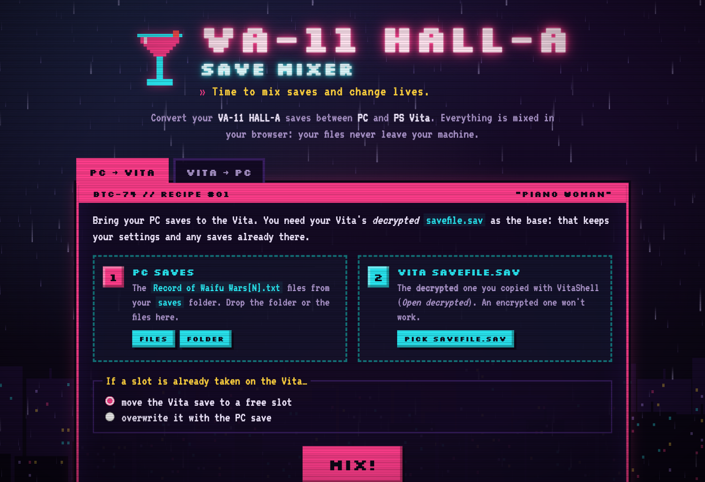

# VA-11 HALL-A Save Mixer

Convert **VA-11 HALL-A** saves between **PC** and **PS Vita**, right in your browser.

**→ [haskou.github.io/va11-save-mixer](https://haskou.github.io/va11-save-mixer/)**



## What it does

- **PC ➜ Vita:** merges your `Record of Waifu Wars[N].txt` files into the Vita's decrypted `savefile.sav`. PC slot N goes to Vita slot N. If that slot already holds a Vita save, it either moves to a free slot or gets overwritten (your choice). Vita settings and the other saves are kept.
- **Vita ➜ PC:** turns every used slot of the Vita `savefile.sav` into a `Record of Waifu Wars[N].txt`, bundled in a ZIP.

Everything runs locally in the browser. Your files are never uploaded.

## Requirements

- A PS Vita with **HENkaku** (h-encore, Enso…) and **VitaShell**, to copy the save out with *Open decrypted* and paste it back.
- At least one save made on the Vita, used as the base.

Step-by-step instructions are on the page.

## Save locations

| Platform | Path |
| --- | --- |
| Windows | `%LOCALAPPDATA%\VA_11_Hall_A\saves` |
| macOS | `~/Library/Application Support/com.yoyogames.macyoyorunner/saves` |
| Linux | `~/.config/VA_11_Hall_A/saves` (lowercase file names) |
| PS Vita | `ux0:user/00/savedata/PCSB01166/savefile.sav` (EU release; open the folder with VitaShell → *Open decrypted*) |

## Format notes

- **PC slot:** plain text, one value per line. Numbers carry a trailing space. Version 1.0 writes 243 lines; later builds append three numbers (246 lines). Shorter v1.0 slots are padded with `0` when converted.
- **Vita `savefile.sav`** (decrypted): a GameMaker INI with a `[data]` section and keys `0`–`29`. Each slot key stores a whole nested INI as an escaped string (`\r\n` → `^r`, `"` → `^q`) holding the 247 slot values in PC order, numbers formatted as `%.6f`. Key `29` holds the Vita settings. The file is NUL-padded to a multiple of 4096 bytes.
- `Waifu Preferences.txt` (PC settings) is not converted.

## Run locally

ES modules need HTTP, so `file://` won't work:

```sh
python3 -m http.server 8765
# open http://127.0.0.1:8765/
```

No build step and no dependencies. The only external resources are the Google Fonts Silkscreen and VT323.

## Disclaimer

Fan-made tool, not affiliated with Sukeban Games or Ysbryd Games. VA-11 HALL-A belongs to its creators. Back up your saves before using it.
